<div align="center">


**Seeing beyond the obvious.**

A hybrid deep-learning pipeline that detects and classifies defects in photovoltaic (PV) panels from electroluminescence (EL) images.


[**Demo videos**](https://drive.google.com/drive/folders/1bsAReEUwmxozrBx8bYj9a-N0-e6rPsRl)

</div>

<!-- Enable after written approval from the data owner and the university (see DATA.md):
<p align="center"></p>
-->

## Overview

EL imaging reveals cracks and dead areas inside solar cells that are invisible to the eye, but in production lines the images are still inspected manually: slow, subjective and hard to scale. **InSpectra** automates this step.

It is a two-stage pipeline, evaluated on a **public** EL dataset and on a **private industrial** dataset from a Saudi PV manufacturer:

1. **Localisation** – an object detector (RT-DETR-X or YOLO11s) finds defects on the full panel image.
2. **Classification** – each detected region is cropped and classified (ResNet50 or EfficientNet-B0) into one of four defect types.

The selected models (**RT-DETR-X + EfficientNet-B0**) are integrated into a closed, internal inspection system used by inspectors and administrators.

**Highlights**

- Two-stage pipeline: detect where, then classify what, with two detectors and two classifiers compared on two datasets.
- Private-data results: RT-DETR-X **49.05 % mAP@50** for localisation and EfficientNet-B0 **87.46 %** accuracy for classification.
- End-to-end inspection system: upload an EL image, get an annotated result with severity and recommendation, history, dashboard and a PDF report.

> Graduation project, B.Sc. Computer Science, Imam Abdulrahman Bin Faisal University (IAU), 2025–2026, supervised by **Dr. Dhiaa A. Musleh**, in collaboration with **Desert Technologies**. The project belongs to the supervisor and the university.

## Pipeline

### Methodology

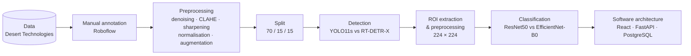

Selected models: **RT-DETR-X + EfficientNet-B0**. The same flow was run on the public dataset (Roboflow EL-Images) and the private one.

### Inference flow in the system

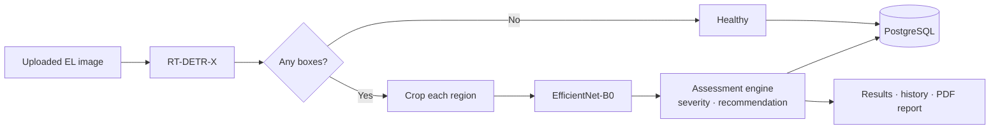

**Defect classes:** Black spot · Cell scratch · Cells class difference · Micro-crack

## Results

Metrics are measured on the **validation split** of each dataset. Final selections are marked ✅.

### Defect localisation

| Dataset | Model | mAP@50 | Precision | Recall | |
|---|---|---:|---:|---:|:-:|
| Public | YOLO11s | 41.68 % | 54.25 % | 45.19 % | |
| Public | RT-DETR-X | 49.61 % | 77.00 % | 48.94 % | ✅ |
| Private | YOLO11s | 48.14 % | 52.83 % | 48.30 % | |
| Private | RT-DETR-X | 49.05 % | 48.24 % | 52.73 % | ✅ |

Per-class mAP@50 of RT-DETR-X on the private validation set: Micro-crack **83.2 %** · Cells class difference 44.1 % · Black spot 38.6 % · Cell scratch 30.3 %.

### Defect classification

| Dataset | Model | Accuracy | Precision | Recall | F1 | |
|---|---|---:|---:|---:|---:|:-:|
| Public | ResNet50 | 83.05 % | 83.74 % | 83.05 % | 82.50 % | ✅ |
| Public | EfficientNet-B0 | 79.66 % | 80.40 % | 79.66 % | 79.70 % | |
| Private | ResNet50 | 87.14 % | 87.34 % | 87.14 % | 87.16 % | |
| Private | EfficientNet-B0 | 87.46 % | 87.45 % | 87.46 % | 87.45 % | ✅ |

### How to read these numbers

- The validation sets are small (private: 29 images / 311 annotated defects). Single runs, no confidence intervals.
- On the private data, EfficientNet-B0 vs ResNet50 differs by **one validation crop** (272 vs 271 of 311), so the two are statistically indistinguishable; EfficientNet-B0 was kept for its efficiency.
- Detection mAP@50 of about 49 % is a baseline: micro-cracks are found reliably, scratches and black spots much less so. Better and larger data is the main lever.
- Public and private results come from different datasets (different classes, image quality and annotation style), so compare models *within* a dataset rather than across them.
- Images come from controlled indoor EL setups; outdoor / drone imagery is future work.

## InSpectra system

React + Vite + Tailwind front end, FastAPI back end, PostgreSQL storage, PDF reports. Role-based access (admin / inspector), JWT in an HTTP-only cookie, bcrypt-hashed passwords.

### Inspector

| Home | Upload EL image | Dashboard |
|:-:|:-:|:-:|
| 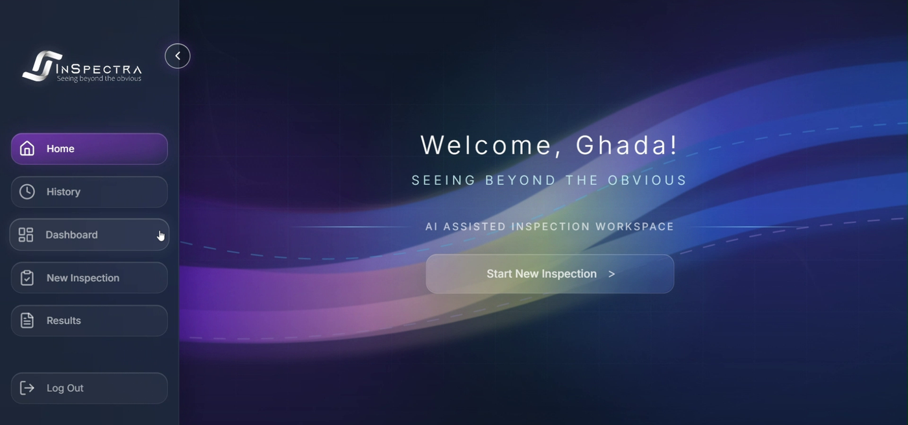 | 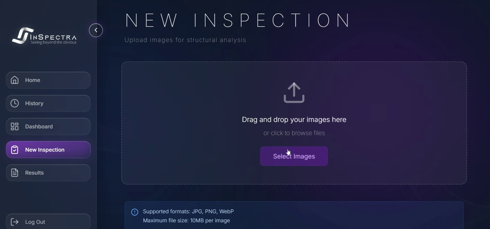 | 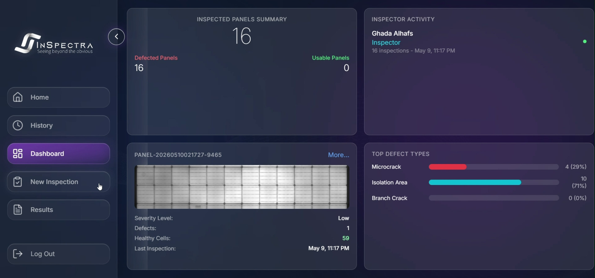 |

| Results: annotated image and summary | Results: original image and details |
|:-:|:-:|
| 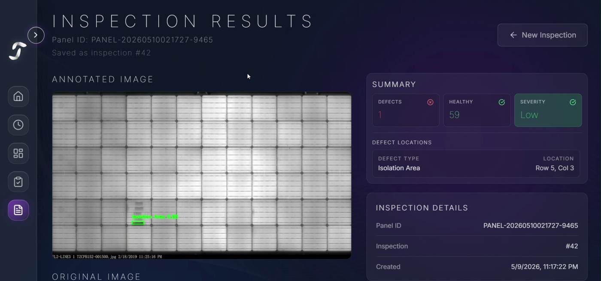 | 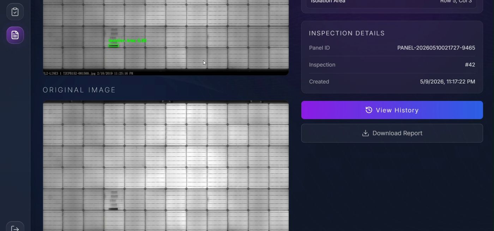 |

| History | PDF report |
|:-:|:-:|
| 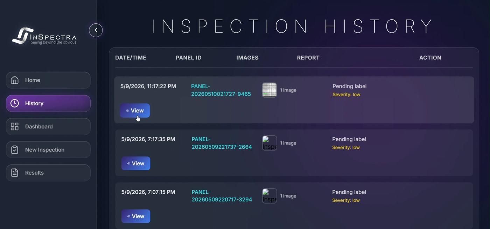 | 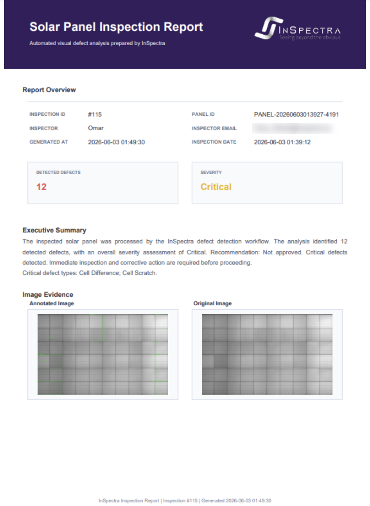 |

### Admin

| Admin home | Inspection history |
|:-:|:-:|
| 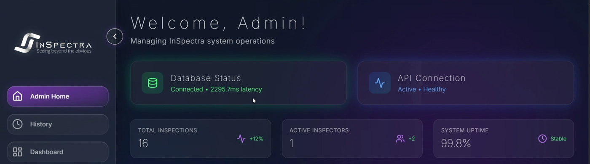 | 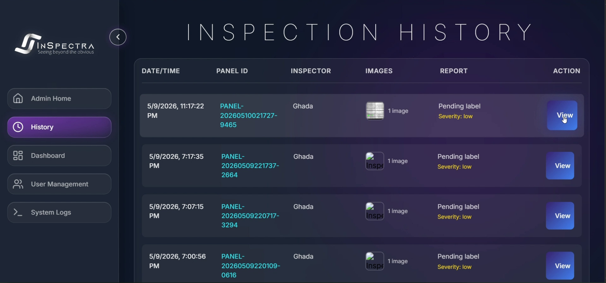 |
| **User management** | **System audit logs** |
| 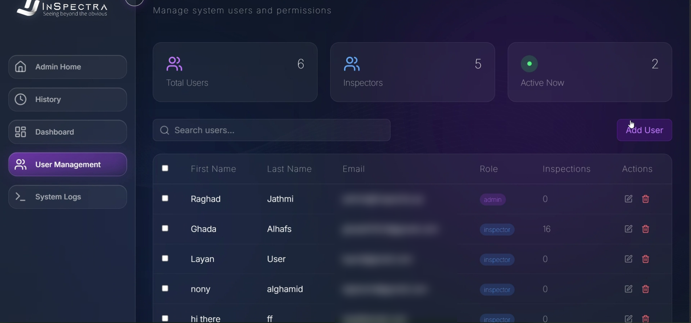 | 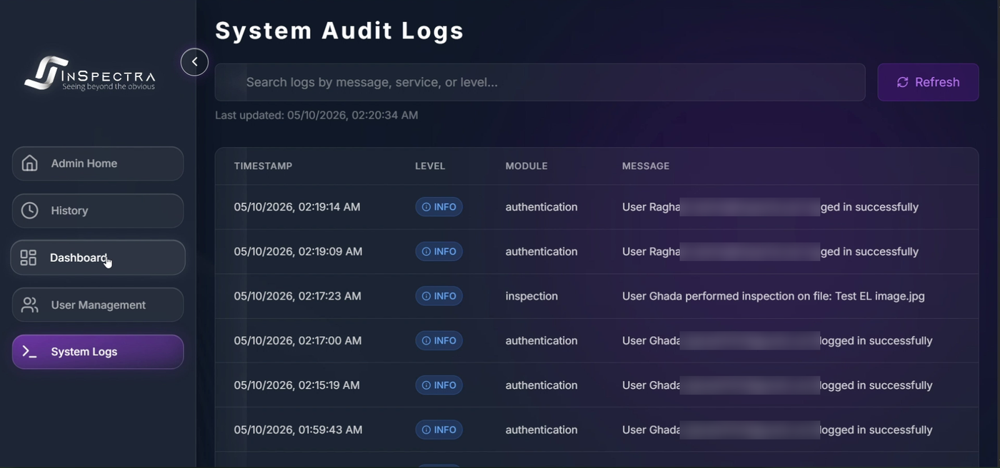 |

The screenshots use demo accounts and test data.

### System architecture

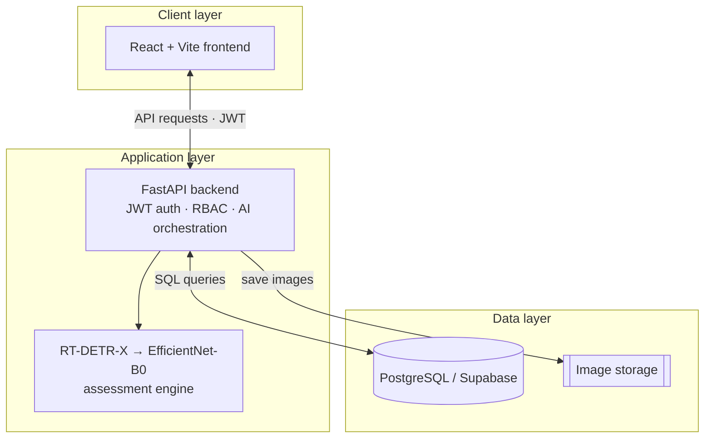

Full walkthrough: [**demo videos (Drive)**](https://drive.google.com/drive/folders/1bsAReEUwmxozrBx8bYj9a-N0-e6rPsRl).

- **Inspector:** upload EL images → annotated result with defect types, locations, severity and recommendation → history, dashboard, PDF report.
- **Admin:** user management and system logs.
- A rule-based assessment engine turns detections into a panel-level verdict. The rules are manufacturer-specific and **are not part of this repository**.

This repository contains the machine-learning pipeline. The system's application source (front end and back end) is not included.

## Repository structure

```
.
├── notebooks/
│   ├── 01_data_preprocessing.ipynb                       # EL preprocessing pipeline
│   ├── 02_detection_yolo11s.ipynb                        # YOLO11s training & evaluation
│   ├── 03_detection_rtdetr.ipynb                         # RT-DETR-X training & evaluation
│   ├── 04_roi_extraction.ipynb                           # detection labels -> classification crops
│   └── 05_classification_resnet50_efficientnetb0.ipynb   # classifier training & evaluation
├── configs/data.example.yaml                             # dataset config template
├── docs/methodology.md                                   # preprocessing & training settings
├── scripts/check_repo.py                                 # guards against leaking data/outputs
├── DATA.md                                               # data availability
└── requirements.txt
```

## Getting started

The notebooks are written for **Google Colab** (GPU). The datasets are **not** included, so bring a YOLO-format EL dataset with this layout:

```
inspectra/
├── detection_dataset_raw/          # train|valid|test / images|labels  + data.yaml
├── detection_dataset_processed/    # same, after preprocessing
├── classification_dataset/         # train|valid|test / <class> / *.jpg   (notebook 04)
└── runs/                           # training outputs
```

1. Copy `configs/data.example.yaml` to your dataset root as `data.yaml`.
2. Run the notebooks in order `01 → 05` and adjust the paths in each *Configuration* cell.
3. The notebooks are set up for the 4-class defect taxonomy (Black spot, Cell scratch, Cells class difference, Micro-crack). With a different dataset, update `CLASS_NAMES` and the oversampled class id.

Local setup: `pip install -r requirements.txt`.

## Data and confidentiality

The private dataset (provided by Desert Technologies), its annotations, the trained weights and the manufacturer's inspection rules are proprietary and are **not** published. Notebook outputs are cleared so that no dataset images are embedded. See [`DATA.md`](DATA.md).

## Future work

Drone-based inspection with InGaAs cameras, fine-tuning on new EL data, and larger, more diverse datasets for better scalability.

## Team

Rahaf J. Alghamdi · Ghada F. Alhafs · Raghad S. Jathmi · Alanood A. Alshabibi · **Layan H. Almohawish**
Supervisor: **Dr. Dhiaa A. Musleh** — College of Computer Science and Information Technology, Imam Abdulrahman Bin Faisal University (IAU).

<!-- Add your own role, e.g.: "My contribution: ..." -->

## Acknowledgements

- **Desert Technologies** for the collaboration and for providing the industrial EL dataset for academic use.
- **Dr. Dhiaa A. Musleh** and **Imam Abdulrahman Bin Faisal University** for supervision and support.
- Public dataset: [*EL-Images*](https://universe.roboflow.com/venkata-prasanth/el-images-p2ove) by Venkata Prasanth, Roboflow Universe, CC BY 4.0.
  We also trained and evaluated the pipeline on it as a public benchmark. It uses a different 3-class taxonomy (Branch crack, Isolation area, Micro-crack) and different imaging conditions from the industrial data, so its results are reported separately and are not directly comparable to the private-data results.

## License

The project was developed at, and belongs to, the supervisor Dr. Dhiaa A. Musleh and Imam Abdulrahman Bin Faisal University (IAU). Code and documentation: [MIT](LICENSE). Datasets and trained models are not covered.
